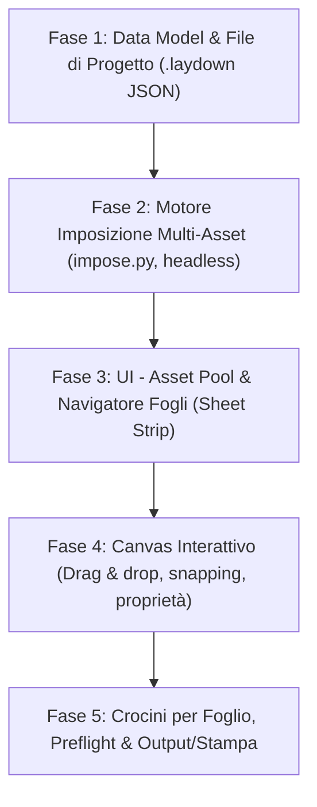

# Roadmap & Architettura — Progetto Multi-Foglio & Multi-PDF (Gang-Run / Montaggio Editoriale)

Documento di progettazione per l'evoluzione di **Laydown** da strumento di imposizione parametrica singola ad ambiente di montaggio avanzato multi-foglio e multi-documento.

Data creazione: 2026-10-28  
Stato: Pianificato / In attesa di avvio sviluppo.

---

## 1. Visione del Prodotto

Passaggio dal modello attuale (**1 PDF sorgente $\rightarrow$ 1 schema di regole $\rightarrow$ $N$ fogli macchina identici**) a un modello di **Progetto di Imposizione Multi-Foglio**:
* **Asset Pool (Libreria Risorse):** caricamento simultaneo di più file PDF sorgente (singole pagine o multipagina).
* **Fogli Macchina Eterogenei (Press Sheets):** ogni foglio può avere dimensioni diverse (es. Foglio 1: SRA3, Foglio 2: 70x100 cm, Foglio 3: A4), orientamento, margini e crocini dedicati.
* **Piazzamento Flessibile (Placements):** posizionamento delle singole pagine dei vari PDF sui fogli macchina, con coordinate esatte, rotazione, scala e gestione delle box di rifilo/abbondanza (Trim/Bleed).

---

## 2. Principi Architetturali

1. **Il Motore (`laydown/engine/`) resta 100% Qt-Free:**
   Tutta la struttura dati del progetto, la geometria di calcolo e l'imposizione vettoriale tramite PyMuPDF (`fitz.Document.show_pdf_page`) sono implementate senza alcuna dipendenza da PyQt6. Questo garantisce testabilità headless al 100% con `pytest`.
2. **Zero Rasterizzazione:**
   Il piazzamento delle pagine avviene sempre come vettori / XObject nativi PDF, preservando la massima fedeltà del documento di origine.
3. **Persistenza di Progetto:**
   Introduzione del formato file di salvataggio `.laydown` (JSON strutturato con percorsi relativi/assoluti agli asset).
4. **Coesistenza e Retrocompatibilità:**
   La modalità corrente (imposizione rapida / parametrica automatica per Booklet e N-Up standard) continua a esistere e può fungere da generatore per il piano fogli.

---

## 3. Data Model Proposto (`laydown/engine/data_model.py`)

```python
@dataclass
class SourceAsset:
    id: str  # identificatore univoco
    file_path: str  # percorso al PDF
    page_count: int
    # Dimensioni e box pre-calcolate per pagina

@dataclass
class PlacedPage:
    asset_id: str
    page_index: int  # 0-based
    x_mm: float
    y_mm: float
    width_mm: float
    height_mm: float
    rotation: int = 0  # 0, 90, 180, 270
    source_box: SourceBox = SourceBox.TRIM
    bleed_override_mm: Optional[float] = None

@dataclass
class SheetDefinition:
    id: str
    name: str  # es. "Foglio 1 (SRA3)"
    sheet_settings: SheetSettings  # formato carta, margini, orientamento
    marks: List[MarkItem]  # crocini specifici per questo foglio
    placements: List[PlacedPage] = field(default_factory=list)

@dataclass
class MultiSheetProject:
    assets: Dict[str, SourceAsset] = field(default_factory=dict)
    sheets: List[SheetDefinition] = field(default_factory=list)
```

---

## 4. Fasi di Sviluppo (Roadmap Esecutiva)



### Fase 1 — Data Model & Serializzazione Progetto
* Definizione delle dataclass per `SourceAsset`, `PlacedPage`, `SheetDefinition` e `MultiSheetProject`.
* Modulo di serializzazione / deserializzazione JSON (salvataggio e apertura progetti `.laydown`).
* Test unitari headless per verificare round-trip (salva $\rightarrow$ carica) e validazione dei campi.

### Fase 2 — Motore di Imposizione Multi-Asset (`laydown/engine/impose.py`)
* Apertura sicura e gestione del pool di documenti `fitz.Document` (prevenzione leak descrittori file).
* Generazione di un documento PDF con formati pagina eterogenei (dimensioni per pagina derivate da ciascun `SheetDefinition`).
* Piazzamento vettoriale delle pagine con `show_pdf_page` secondo coordinate $(X, Y)$, rotazione e clip box.
* Test di banco sintetici con asserzione delle coordinate di arrivo di ciascun elemento.

### Fase 3 — UI: Gestione Risorse (Asset Pool) e Gestione Fogli
* **Asset Drawer:** pannello laterale sinistro per caricare PDF multipli, con visualizzazione ad albero / miniature delle pagine disponibili.
* **Sheet Strip (Barra Fogli):** componente visivo a schede/miniature per scorrere i fogli, aggiungere fogli (+), duplicare, eliminare e riordinare.
* **Pannello Impostazioni Foglio:** modifica di preset carta, dimensioni custom, margini e orientamento applicati selettivamente al foglio attivo.

### Fase 4 — Canvas Interattivo & Posizionamento
* Visualizzatore del foglio attivo interattivo (`QGraphicsView` o canvas personalizzato con supporto eventi mouse).
* Drag & Drop: trascinamento di una pagina dall'Asset Pool direttamente sul foglio.
* Spostamento libero con snapping magnetico ai margini del foglio e agli altri elementi.
* Pannello proprietà contestuale: selezione di un elemento per impostare coordinate precise, rotazione e scala.

### Fase 5 — Crocini per Foglio, Preflight & Esportazione / Stampa
* Calcolo e disegno dei crocini di taglio, barre colore e note perimetrali adattati alle geometrie di ciascun foglio.
* Preflight esteso multi-foglio (controllo elementi fuori foglio, sovrapposizioni non desiderate, bleed mancante).
* Esportazione del PDF finale conforme agli standard ISO e collegamento alla finestra di stampa / invio RIP esistente.

---

## 5. Domande e Decisioni Aperte (da affrontare alla ripresa)
1. **Modalità di posizionamento:** prioritario il posizionamento libero continuo (stile InDesign/Illustrator) o supporto a griglie parametriche per singolo foglio (stile Gang-Run slot)?
2. **Coesistenza:** selettore di modalità all'avvio o creazione progetto ("Imposizione Rapida" vs "Progetto Multi-Foglio")?
3. **Pagine multipagina:** supporto alla distribuzione automatica sequenziale di un documento multipagina sui fogli creati.
